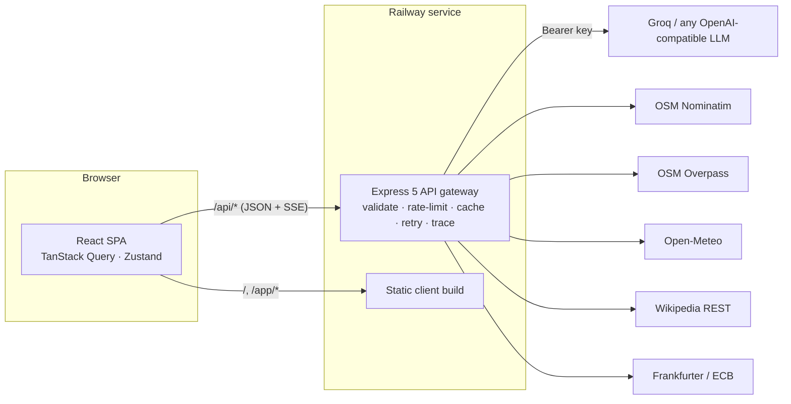

# Itinera: AI travel desk

**From enquiry to invoice, at the speed of a prompt.**

Itinera is a full-stack web app for tour operators. You paste a raw customer enquiry (an email, a WhatsApp chat or call notes) and Itinera:

1. **extracts a structured lead** with an LLM and lists what the agent still needs to ask,
2. **streams a day-wise itinerary** while the model is still writing it,
3. **prices it** with editable cost lines, agency markup, 5% GST and live exchange rates,
4. **issues documents**: a branded quotation, a hotel/service voucher and a GST tax invoice (PDF), and
5. **shows every API call behind the scenes** in a built-in API Console.

The workflow follows the *query → quotation → voucher → invoice* pipeline that travel CRMs are built around, such as DeBox Global's TravCRM. The project's focus is **API integration**: one Express gateway orchestrates an LLM and six free travel-data APIs, with validation, caching, retries, fallbacks, rate limiting and request tracing.

> Built as an internship project at **DeBox Global IT Solutions, Noida**. This is v2: a full rewrite of the original single-page hotel search prototype, which is kept in [`docs/legacy`](docs/legacy) for comparison.

---

## Contents

- [What changed from v1](#what-changed-from-v1)
- [Features](#features)
- [Architecture](#architecture)
- [Integrated APIs](#integrated-apis)
- [REST API reference](#rest-api-reference)
- [Tech stack](#tech-stack)
- [Getting started](#getting-started)
- [Deploying to Railway](#deploying-to-railway)
- [Environment variables](#environment-variables)
- [Project structure](#project-structure)
- [Testing](#testing)
- [Roadmap](#roadmap)

---

## What changed from v1

| | v1 prototype | v2 (this repo) |
|---|---|---|
| Architecture | One HTML file calling Groq directly from the browser | React SPA → Express API gateway → 7 external APIs |
| API key | Hard-coded in `script.js`, visible to every visitor | Server-side env var only; never sent to the browser |
| LLM output handling | Regex for `[...]`, then `JSON.parse` | JSON mode, schema validation (zod), salvage of wrapped JSON, per-item rejection |
| Streaming | None (waited for 100 hotels) | Server-Sent Events, parsed into validated day objects as tokens arrive |
| Data | 100 AI-invented hotels per call, incl. phone numbers | AI *sample* inventory (no invented contacts) **plus** real hotels from OpenStreetMap |
| Resilience | One try/catch | Timeouts, retries with backoff, TTL cache, provider fallback, partial-failure tolerance |
| Excel export | Button present, function missing | Working `.xlsx` export for hotels and leads |
| Business workflow | Hotel list only | Leads → quotes → vouchers → GST invoices, with an agency profile |
| Observability | `console.log` | `x-request-id`, per-response upstream waterfall, live traffic feed, health checks |
| UI | Unstyled HTML | React 19, Tailwind CSS v4, shadcn/ui, Phosphor icons, Motion animations, light/dark |
| Deployment | VS Code Live Server | One Railway service with a health check |

---

## Features

**Landing page**: an animated product walkthrough, a live integration diagram (request/response packets travelling between the browser, the gateway and each provider), feature bento, code samples and an FAQ.

**Workspace (`/app`)**

| Screen | What it does | APIs involved |
|---|---|---|
| Dashboard | Pipeline stats, enquiries by stage, recent quotes, integration status | `/meta/integrations` |
| Enquiries | Paste an enquiry, extract a lead, manage the pipeline, draft WhatsApp follow-ups, export to Excel | LLM (JSON mode) |
| Quote builder | Trip form, destination intel, hotel picker, **streamed itinerary**, costing with markup/GST/FX, PDF quotation, client email draft, voucher, GST invoice | LLM (SSE), Nominatim, Open-Meteo, Wikipedia, Frankfurter |
| Hotel finder | AI sample inventory with filters, pagination and de-duplication; real OSM hotels; shortlist; Excel export | LLM, Nominatim, Overpass |
| Destinations | One call fans out to geocoding, weather, Wikipedia and FX | Nominatim → Open-Meteo fallback, Open-Meteo, Wikipedia, Frankfurter |
| API Console | Provider catalogue and live health checks, a live upstream traffic feed (SSE), your browser's requests with waterfalls, and a playground with cURL/fetch snippets for every endpoint | all |
| Settings | Agency profile (name, GSTIN, state, bank details) used on every PDF; default markups and GST | none |

**Demo mode**: if no LLM key is configured, AI routes return deterministic sample output (including a simulated token stream). The free APIs are still called live, so the whole app can be presented without a key.

---

## Architecture



**Integration patterns implemented**

| Pattern | Where |
|---|---|
| Backend-for-frontend / API gateway (secrets stay server-side) | [`server/src/index.js`](server/src/index.js) |
| Timeouts with `AbortSignal.timeout()` | [`server/src/lib/upstream.js`](server/src/lib/upstream.js) |
| Retry with exponential backoff and jitter, honouring `Retry-After` | `upstream.js` |
| TTL + LRU cache (geocode 7 d, forecast 30 min, FX 6 h, hotels 24 h) | [`server/src/lib/cache.js`](server/src/lib/cache.js) |
| Provider fallback: Nominatim → Open-Meteo (geocoding), Overpass → Nominatim (hotels) | [`server/src/services/geo.js`](server/src/services/geo.js), [`providers/openStreetMap.js`](server/src/providers/openStreetMap.js) |
| Fan-out with partial-failure tolerance (`Promise.allSettled`) | [`server/src/routes/travel.js`](server/src/routes/travel.js) |
| Client-side politeness queue (Nominatim's 1 req/s policy) | [`server/src/providers/nominatim.js`](server/src/providers/nominatim.js) |
| LLM JSON mode + schema validation + salvage | [`server/src/providers/llm.js`](server/src/providers/llm.js), [`server/src/ai/schemas.js`](server/src/ai/schemas.js) |
| Streaming: provider SSE → incremental JSON object parser → typed SSE events | [`server/src/lib/jsonStream.js`](server/src/lib/jsonStream.js), [`routes/ai.js`](server/src/routes/ai.js) |
| POST + SSE consumption in the browser (no `EventSource`) | [`client/src/lib/api.ts`](client/src/lib/api.ts) |
| Request tracing: `x-request-id` + `meta.upstream` waterfall on every response | [`server/src/lib/trace.js`](server/src/lib/trace.js) |
| Rate limiting (per IP, stricter on AI routes) | `express-rate-limit` in `index.js` |
| Uniform envelope `{ data, meta }` / `{ error, meta }` | [`server/src/lib/http.js`](server/src/lib/http.js) |

---

## Integrated APIs

| Provider | Used for | Auth | Cache | Docs |
|---|---|---|---|---|
| **Groq** (OpenAI-compatible Chat Completions) | Lead extraction, sample hotel inventory, streamed itineraries, client messages | Bearer key (server) | none | [console.groq.com/docs](https://console.groq.com/docs) |
| **OpenStreetMap Nominatim** | Geocoding cities *and* regions (Goa, Kerala, Bali); hotel fallback | None; User-Agent, 1 req/s | 7 d | [nominatim.org](https://nominatim.org/release-docs/latest/api/Search/) |
| **OpenStreetMap Overpass** | Real hotels around a destination | None, fair use | 24 h | [Overpass API](https://wiki.openstreetmap.org/wiki/Overpass_API) |
| **Open-Meteo Forecast** | 7-day forecast, current conditions | None | 30 min | [open-meteo.com](https://open-meteo.com/en/docs) |
| **Open-Meteo Geocoding** | Fallback geocoder | None | 24 h | [open-meteo.com](https://open-meteo.com/en/docs/geocoding-api) |
| **Wikipedia REST** | Destination summary and image | None; User-Agent | 24 h | [REST API](https://en.wikipedia.org/api/rest_v1/) |
| **Frankfurter** | ECB reference exchange rates | None | 6 h | [frankfurter.dev](https://frankfurter.dev) |

---

## REST API reference

All JSON responses use `{ data, meta }`. `meta` contains `requestId`, `durationMs` and `upstream[]` (provider, label, URL with secrets redacted, status, start offset, latency, cache hit, attempts, tokens).

| Method | Path | Description |
|---|---|---|
| GET | `/api/health` | Liveness probe (used by Railway) |
| GET | `/api/destination?city=&base=INR` | Geocode → forecast + Wikipedia + FX in parallel |
| GET | `/api/fx?base=INR&symbols=USD,EUR` | Latest ECB rates |
| GET | `/api/hotels/real?city=&radius=` | Real OSM hotels (Overpass, Nominatim fallback) |
| POST | `/api/ai/enquiry` | `{ text, today? }` → structured lead |
| POST | `/api/ai/hotels` | `{ city, page, count, filters, exclude[] }` → sample inventory |
| POST | `/api/ai/itinerary` | **SSE**: `start` → `token`* → `day`* → `summary` → `done` / `error` |
| POST | `/api/ai/compose` | `{ kind, tone, context }` → `{ subject, body }` |
| GET | `/api/meta/integrations` | Provider catalogue and live call statistics |
| GET | `/api/meta/health-check` | Pings every provider live, uncached |
| GET | `/api/meta/logs?limit=` | Recent upstream calls |
| GET | `/api/meta/logs/stream` | **SSE** live feed of upstream calls |

Try them in the in-app **API Console → Playground**, or with cURL:

```bash
curl -s "http://localhost:8080/api/destination?city=Udaipur"
```

```bash
curl -sN -X POST http://localhost:8080/api/ai/itinerary -H "Content-Type: application/json" -d '{"destination":"Rishikesh","nights":2,"adults":2}'
```

---

## Tech stack

- **Client**: React 19, TypeScript, Vite, React Router, TanStack Query, Zustand (persisted), Tailwind CSS v4, shadcn/ui (Radix), Phosphor Icons, Motion, jsPDF + AutoTable, write-excel-file, Fontsource (Bricolage Grotesque, Geist, Instrument Serif, JetBrains Mono)
- **Server**: Node 20+, Express 5, zod, helmet, cors, compression, express-rate-limit, morgan. Native `fetch`, no SDKs, so every integration is visible in plain code.
- **Hosting**: Railway (single service: API + static client)

---

## Getting started

Prerequisites: **Node.js 20.12+** and npm.

```bash
npm install
```

```bash
cp server/.env.example server/.env
```

Optionally put your Groq key in `server/.env` as `LLM_API_KEY=...`. Without it, the app runs in demo mode.

```bash
npm run dev
```

- Client: http://localhost:5173 (Vite proxies `/api` to the server)
- API: http://localhost:8080

Production-like run (Express serves the built client):

```bash
npm run build
```

```bash
npm start
```

Then open http://localhost:8080.

---

## Deploying to Railway

The repo is ready for a single Railway service. [`railway.json`](railway.json) sets the build (`npm run build`), start (`npm start`) and health check (`/api/health`).

1. Push the repository to GitHub.
2. In Railway: **New Project → Deploy from GitHub repo**, and select the repository. Railpack detects Node and installs the workspaces.
3. Under **Variables**, add:
   - `NODE_ENV=production`
   - `LLM_API_KEY=<your Groq key>` (omit for demo mode)
   - optionally `LLM_MODEL`, `CONTACT_EMAIL`
4. Under **Settings → Networking**, click **Generate Domain**.
5. Open the domain. `/api/health` should return `{"status":"ok"}`.

Railway injects `PORT`; the server reads it automatically.

**Hosting the client separately (optional).** You can deploy `client/` to any static host and point it at the Railway API by setting `VITE_API_URL=https://<your-api>.up.railway.app` at build time. Then set `CORS_ORIGINS` on the server to the client's origin.

---

## Environment variables

| Variable | Default | Purpose |
|---|---|---|
| `PORT` | `8080` | Injected by Railway |
| `NODE_ENV` | — | `production` enables combined logs |
| `LLM_API_KEY` | — | Groq (or other provider) key. Empty means demo mode |
| `LLM_BASE_URL` | `https://api.groq.com/openai/v1` | Any OpenAI-compatible endpoint |
| `LLM_MODEL` | `openai/gpt-oss-120b` | Model ID available to your key |
| `LLM_REASONING_EFFORT` | `low` | Sent only to reasoning models (gpt-oss) |
| `CORS_ORIGINS` | `http://localhost:5173` | Comma-separated allow-list when the client is hosted elsewhere |
| `AI_RATE_LIMIT_PER_MIN` | `20` | Per-IP limit on `/api/ai/*` |
| `CONTACT_EMAIL` | — | Added to the User-Agent for Wikipedia/OSM usage policies |
| `VITE_API_URL` (client, build time) | same origin | API base URL when the client is hosted separately |

> **Security note:** never commit API keys. If a key was ever committed to a repository (the v1 prototype did this), revoke it in the provider's console and issue a new one. Removing it from the latest commit does not remove it from git history.

---

## Project structure

```
├── client/                     React app (Vite)
│   └── src/
│       ├── components/
│       │   ├── landing/        Landing page sections and animations
│       │   ├── app/            Shell, trace popover, shared UI
│       │   ├── quote/          Destination panel, itinerary view, pricing editor
│       │   └── ui/             shadcn/ui components (Phosphor icons)
│       ├── lib/                API client (JSON + SSE), pricing/GST, PDF, Excel, formatting
│       ├── pages/              Landing + workspace pages
│       └── store/              Zustand stores (CRM, settings, API log)
├── server/                     Express API gateway
│   ├── src/
│   │   ├── ai/                 Prompts, zod schemas, demo-mode generators
│   │   ├── lib/                upstream client, cache, tracing, SSE helpers, JSON stream parser
│   │   ├── providers/          LLM, Nominatim, Overpass, Open-Meteo, Wikipedia, Frankfurter
│   │   ├── routes/             /api/ai, /api/meta, travel routes
│   │   └── services/           Geocoding with fallback
│   └── test/                   node:test unit tests
├── docs/
│   ├── HotelDocFinal.pdf       Original internship documentation (v1)
│   ├── ROADMAP.md              Extension ideas and presentation plan
│   └── legacy/                 v1 prototype (API key redacted)
└── railway.json                Railway build/deploy config
```

---

## Testing

```bash
npm test
```

```bash
npm run typecheck
```

The server tests cover the streaming JSON parser, JSON salvage, the TTL/LRU cache, schema coercion and the demo enquiry parser.

---

## Roadmap

See [`docs/ROADMAP.md`](docs/ROADMAP.md): real supplier inventory (Amadeus), Razorpay payment links, WhatsApp Cloud API intake, Postgres persistence, loyalty points, scheduled reports and more.

---

Data © OpenStreetMap contributors (ODbL) · Weather data by Open-Meteo (CC BY 4.0) · Wikipedia content (CC BY-SA 4.0) · Exchange rates by Frankfurter / European Central Bank. AI-generated content is for prototyping; verify rates and availability before booking.
